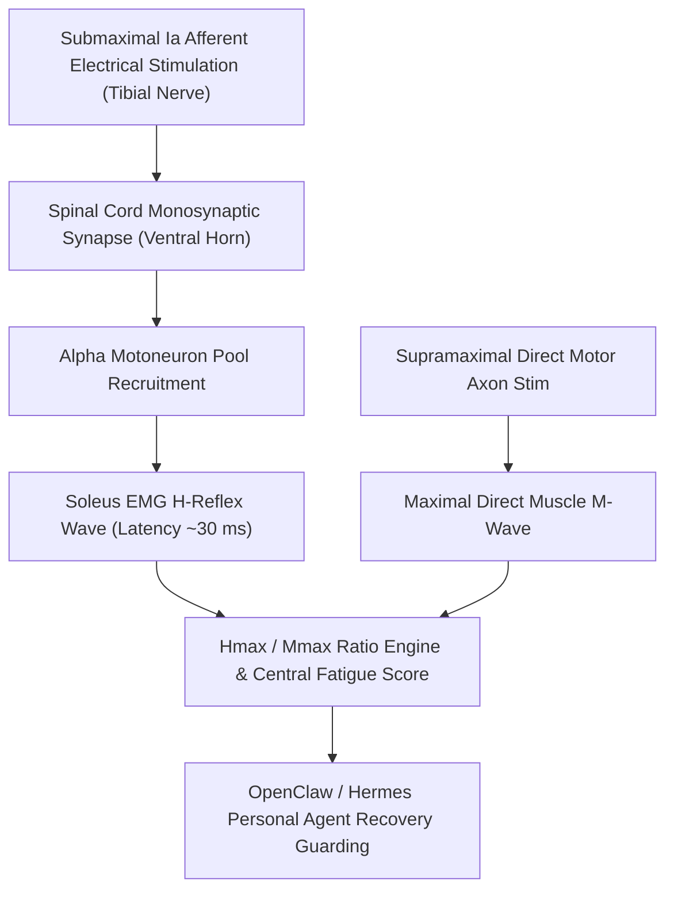

# Somatosensory Hoffmann Reflex (H-Reflex) Skill

[](LICENSE)
[](https://www.python.org/)
[](requirements.txt)
[](mcp_server.py)
[](SKILL.md)

Zero-dependency sovereign personal agent skill for non-invasive evaluation of Hoffmann Reflex (H-Reflex) $H_{max} / M_{max}$ recruitment ratio, reflex onset latency, and spinal alpha motoneuron pool neuromuscular excitability.



## Features
- **Deterministic Math**: Pure Python standard library implementation with zero external dependencies.
- **Electroneuromyography (ENMG) Standards**: Formulates Hmax/Mmax recruitment curves, monosynaptic transmission latency, and presynaptic inhibition.
- **Central Neuromuscular Fatigue**: Highly sensitive detection of spinal motoneuron exhaustion vs peripheral muscle fatigue.
- **Model Context Protocol (MCP)**: Native JSON-RPC tool integration for LLMs and autonomous agents.

## Quickstart

```python
from client import SomatosensoryHReflexClient

client = SomatosensoryHReflexClient()
result = client.evaluate_h_reflex(
    h_max_amplitude_mv=4.2,
    m_max_amplitude_mv=7.8,
    h_latency_ms=30.4
)
print("Hmax / Mmax Ratio:", result["h_m_ratio_pct"], "%")
print("Spinal Excitability Score:", result["spinal_excitability_score"])
print("Classification:", result["classification"])
```

## License
Apache-2.0
